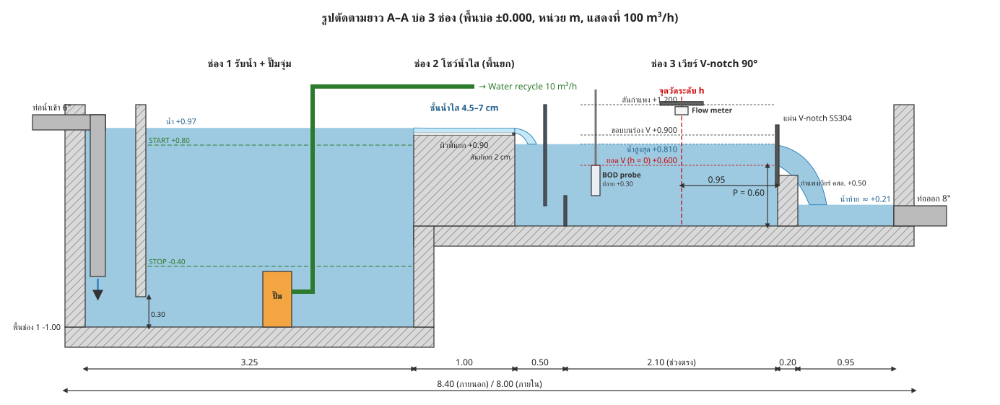
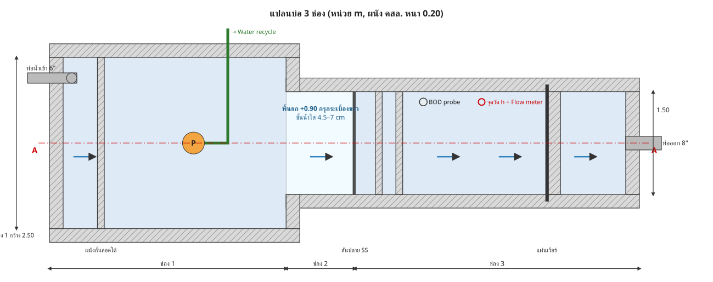
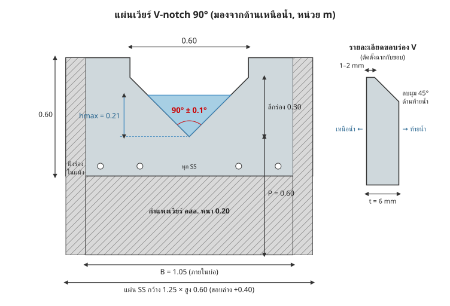

# บ่อเวียร์ V-notch 90° สำหรับวัดอัตราการไหล

ส่วนนี้ออกแบบ **บ่อเวียร์** ในระบบ: ท่อน้ำเข้า 6" → บ่อปั๊ม (สูบไป Water recycle 10 m³/h) → **บ่อเวียร์** → ท่อออก 8"
บ่อปั๊มและส่วนเชื่อมต่อจะออกแบบในขั้นต่อไป

| ไฟล์ | รายละเอียด |
|---|---|
| `weir_design.py` | คำนวณและตรวจสอบแบบตามเกณฑ์ ISO 1438 |
| `make_drawings.py` | สร้างแบบ SVG ในโฟลเดอร์ `drawings/` |
| `rating_table.csv` | ตาราง h–Q ทุก 1 cm |

## 1. ข้อมูลออกแบบ

| รายการ | ค่า |
|---|---|
| น้ำเข้าสูงสุด | 1,507 m³/วัน ÷ 24 ชม. (ปั๊มส่งเดิน 24 ชม.) = **62 m³/h** |
| สูบไป Water recycle | 10 m³/h |
| ผ่านเวียร์ปกติ | **52 m³/h** |
| ผ่านเวียร์สูงสุด (ใช้ออกแบบ เผื่อกรณีปั๊ม recycle หยุด) | **62 m³/h** |
| ท่อออก | 8" |

## 2. ระดับน้ำเหนือยอด V (h)

สมการ Kindsvater–Shen (ISO 1438) สำหรับ V-notch 90°:

$$Q\;[\text{m}^3/\text{s}] = 1.365\,(h + 0.00085)^{2.5}$$

| Q ผ่านเวียร์ | กรณี | **h** |
|---|---|---|
| 62 m³/h | ปั๊ม recycle หยุด | **17.3 cm** |
| 52 m³/h | ใช้งานปกติ | **16.1 cm** |

## 3. แบบ







## 4. ขนาดและการตรวจสอบ

| รายการ | เกณฑ์ (fully contracted) | แบบนี้ |
|---|---|---|
| h ใช้งาน | 0.05 – 0.38 m | 0.16 – 0.17 m ✔ |
| ความสูงยอด V จากพื้น P | ≥ 0.45 m และ h/P ≤ 0.4 | **0.50 m** (h/P = 0.35) ✔ |
| ความกว้างภายในบ่อ B | ≥ 0.90 m และ h/B ≤ 0.2 | **1.00 m** (h/B = 0.17) ✔ |
| ความลึกร่อง V | ≥ hmax + 8 cm | **0.30 m** (ปากกว้าง 0.60 m) ✔ |
| ช่วงตรงหน้าเวียร์ | ≥ 10·hmax = 1.73 m | **1.80 m** ✔ |
| จุดวัดระดับ h | 4–5·hmax = 0.69–0.87 m เหนือแผ่นเวียร์ | **0.80 m** ✔ |
| ความเร็วน้ำหน้าเวียร์ | < 0.15 m/s | 0.03 m/s ✔ |
| น้ำท้ายเวียร์ | ต่ำกว่ายอด V ≥ 6 cm (≤ +0.44) | ≈ +0.15 ✔ |

**ขนาดบ่อ:** ภายใน 3.60 × 1.00 m ผนัง คสล. หนา 0.20 m (ภายนอก 4.00 × 1.40 m) สูงจากพื้นบ่อ 1.00 m

**ระดับ (พื้นบ่อ = ±0.000)**

| ระดับ | m |
|---|---|
| สันกำแพง | +1.000 |
| ขอบบนร่อง V | +0.800 |
| น้ำสูงสุด (62 m³/h) | +0.673 |
| น้ำปกติ (52 m³/h) | +0.661 |
| ยอด V | +0.500 |
| น้ำท้ายสูงสุดที่ยอมได้ | +0.440 |
| ท้องท่อออก 8" | ±0.000 |

## 5. ส่วนประกอบ (เรียงตามทิศทางการไหล)

1. **โซนรับน้ำ (ยาว 0.60 m):** ท่อน้ำเข้าแทงเข้าที่ระดับท้องท่อประมาณ +0.30 ให้น้ำพุ่งชนผนังกั้น ห้ามวางท่อต่ำจนน้ำพุ่งลอดช่องใต้ผนังกั้นไปตรง ๆ
2. **ผนังกั้นลอดใต้:** คสล. หนา 0.10 m ขอบบนเสมอสันกำแพง ขอบล่างอยู่ที่ +0.25 (เว้นช่องลอดสูง 0.25 m) ความเร็วลอดช่องที่ Qmax ประมาณ 0.07 m/s ทำหน้าที่สลายแรงพุ่งของน้ำและคลื่นผิวน้ำ
3. **แผ่นกันคลื่นรูพรุน:** อยู่ห่างผนังกั้น 0.40 m ทำจาก SS304 หรือ PP มีรูเปิด 40–50 % ช่วยกระจายความเร็วให้เท่ากันทั้งหน้าตัด
4. **ช่วงตรงหน้าเวียร์ (ยาว 1.80 m):** พื้นเรียบ ได้ระดับ ไม่มีสิ่งกีดขวาง จุดวัดระดับ h อยู่ห่างแผ่นเวียร์ 0.80 m ทำเป็นท่อต่อเข้าบ่อนิ่ง (stilling well) ตั้ง zero ที่ระดับยอด V (+0.500)
5. **แผ่นเวียร์ V-notch 90°**
   - SS304 หนา 6 mm ขนาด 1.20 × 0.90 m ฝังร่องผนังข้างละ 0.10 m และใส่ยางกันซึม
   - มุมร่อง 90° ± 0.1° และเส้นแบ่งครึ่งมุมต้องตั้งดิ่ง
   - ขอบร่องเป็นสันคมกว้าง 1–2 mm ด้านเหนือน้ำ และลบมุม 45° ด้านท้ายน้ำ
   - หน้าแผ่นด้านเหนือน้ำต้องเรียบ ไม่มีหัวน็อตยื่น
6. **ช่องท้ายเวียร์ (ยาว 0.80 m):** ม่านน้ำ (nappe) ต้องมีอากาศเข้าใต้ได้ ส่วนท่อออก 8" อยู่ที่พื้นบ่อ และปลายทางต้องไม่ทำให้น้ำท้ายเวียร์ยกตัวเกิน +0.44
7. **วาล์วระบายตะกอน:** ติดตั้งขนาด 4" ที่พื้นบ่อด้านหน้าแผ่นเวียร์ ใช้ล้างตะกอนที่ทำให้ค่า P เปลี่ยน

## 6. วิธีใช้โปรแกรม

```bash
python3 weir_design.py
python3 weir_design.py --qmax 70 --qnormal 60
python3 weir_design.py --csv rating_table.csv
python3 make_drawings.py
```

> แบบนี้เป็นแบบเบื้องต้นด้านชลศาสตร์ ส่วนโครงสร้าง คสล. ต้องให้วิศวกรโยธาออกแบบและรับรองตามหน้างาน
