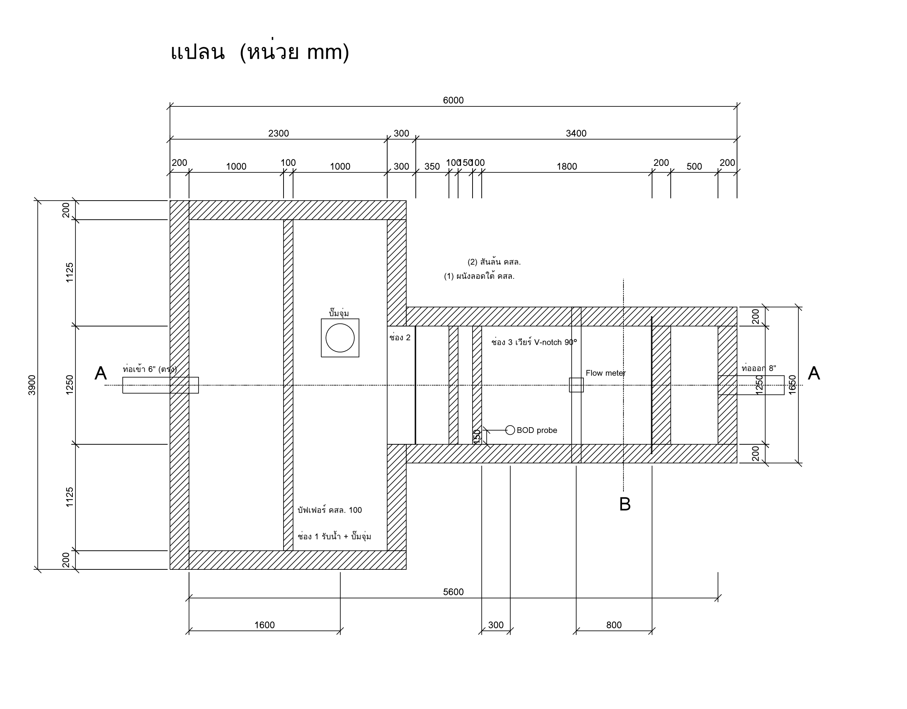
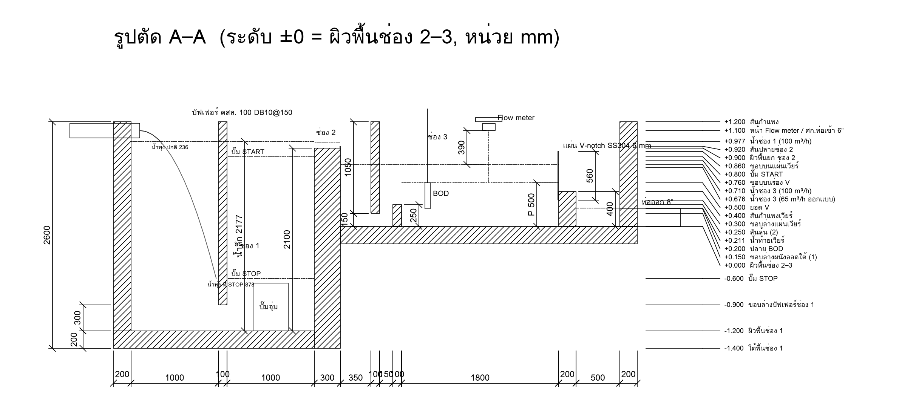
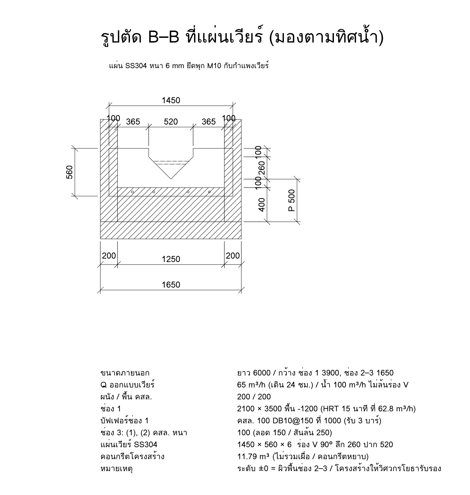

# บ่อ 3 ช่อง: ปั๊มจุ่ม | ม่านน้ำ | เวียร์ V-notch 90°

```
ท่อ 6" (ตรง) → [ช่อง 1 บัฟเฟอร์ + ปั๊มจุ่ม] → [ช่อง 2 สันม่านน้ำ] → [ช่อง 3 ① ② → ช่วงตรง → V-notch 90°] → ท่อ 8"
                          │
                          └→ Water recycle 10 m³/h
```

| ไฟล์ | รายละเอียด |
|---|---|
| `weir_design.xlsx` | **ไฟล์คำนวณหลัก** แก้ช่องสีเหลืองแล้วทุกขนาดคำนวณใหม่ (ชีต 3 = ที่มาของทุกขนาด) |
| `cad/weir_tank.dxf` | **ไฟล์ CAD** (DXF หน่วย mm: แปลน / รูปตัด A–A / B–B) สร้างจาก `make_dxf.py` |
| `cad/*.png` | รูปจากไฟล์ CAD (`python3 cad/render_dxf.py cad/weir_tank.dxf cad`) |
| `animation/weir-animation.html` | ภาพเคลื่อนไหว ปรับน้ำเข้า / เปิด–ปิดปั๊มได้ |
| `docs/docs_sensor_highlight.pdf` | หน้าเอกสารเซนเซอร์ (Flow meter / BOD) ไฮไลท์ข้อกำหนดติดตั้ง |
| `make_xlsx.py` / `weir_design.py` | สร้าง Excel / ตัวตรวจแบบ Python |

## 1. ข้อมูลออกแบบ

| รายการ | ค่า |
|---|---|
| น้ำเข้า (ตามใบเสนอราคา) | 50 – 100 m³/h (เฉลี่ย 1,507 m³/วัน = 62.8 m³/h) |
| **Q ออกแบบเวียร์** | **65 m³/h** (เดินระบบ 24 ชม.) → H = 0.176 m |
| ตรวจกรณีน้ำ 100 m³/h | H = 0.210 m **ไม่ล้นร่อง V** (เหลือ 5 cm) — ช่วงนี้แม่นน้อยลงเล็กน้อย (ยอมรับแล้ว) |
| สูบไป Water recycle | 10 m³/h |
| HRT ช่อง 1 | 15 นาที ที่ 62.8 m³/h (หัวหน้ากำหนด) |
| สูตรเวียร์ (กรมควบคุมมลพิษ) | Q = 1.38 H<sup>2.5</sup> (Flow meter ใช้สูตร ISO 1.365(h+0.0008)<sup>2.5</sup> ต่างกัน < 0.5%) |

## 2. แบบ (จากไฟล์ CAD)







## 3. ที่มาของขนาด (สรุปจากชีต 3 ใน Excel)

| ขนาด | วิธีคิด | ขั้นต่ำ | ใช้ |
|---|---|---|---|
| **P** ยอด V จากพื้น | MAX(0.45, H ÷ 0.4) + เผื่อตะกอน 0.05 | 0.50 | **0.50** |
| ลึกร่อง V | H + 0.08 (ปัดทีละ 0.01 ตัดเลเซอร์) | 0.256 | **0.26** (ปาก 0.52) |
| **B** กว้างภายใน | MAX(0.90, H ÷ 0.2, ปากร่อง + 2 × 2H) ISO + USBR/มข. | 1.226 | **1.25** |
| ช่วงตรงหน้าเวียร์ | 10 × H | 1.765 | **1.80** |
| Flow meter ห่างแผ่นเวียร์ | 4.5 × H (ISO 4–5H / คู่มือ IS-4000 ≥ 3–4h) | 0.794 | **0.80** |
| ช่องท้ายเวียร์ | ระยะทำงาน (ยอมให้ม่านน้ำ V ชนผนังท้าย น้ำท้าย +0.21 ยังต่ำกว่ายอด V) | 0.50 | **0.50** |
| โซนรับม่านน้ำ ช่อง 3 | MAX(ระยะทำงาน 0.50, ระยะฟองลอย 0.21) − ระยะ ①–② | 0.35 | **0.35** |
| ① ผนังลอดใต้ / ② สันล้น (คสล. หนา 0.10) | ช่องลอด = Q ÷ (B × 0.10) / สันล้น = ช่องลอด + 0.10 | 0.134 / 0.25 | **ลอด 0.15, ห่าง 0.15, สัน 0.25** |
| ช่อง 2 (สันม่านน้ำ) | เลือก — พื้นยก +0.90 ม่านน้ำตกสูง 0.24 m ที่ Q ออกแบบ | — | **0.30** |
| ช่อง 1 | HRT 15 นาที: 15.8 m³ ÷ (3.50 × น้ำลึก 2.16) / อุปกรณ์: บัฟเฟอร์ 1.00 + 0.10 + โซนปั๊ม 1.00 | 2.09 / 2.10 | **2.10 × 3.50 พื้น −1.20** |
| บัฟเฟอร์ช่อง 1 | น้ำพุ่งไกลสุดตอนน้ำลดถึง STOP 0.88 m / รับแรงดัน 3 บาร์: Mu 8.3 ≤ φMn 8.5 kN·m | — | **คสล. 0.10 DB10@150 ที่ 1.00** |
| ท่อเข้า 6" | ท่อตรง ไม่หักลง ศก. +1.10 | — | — |
| แผ่นเวียร์ SS304 | กว้าง B + 0.20 / +0.30 ถึง P + ร่อง + 0.10 | — | **1.45 × 0.56 m หนา 6 mm** |
| ผนัง/พื้น คสล. | ผนังช่อง 2–3 ตามเหล็กขั้นต่ำ / ผนังช่อง 1 สูง 2.40 | — | **0.20 m**, DB12@175 / ช่อง 1 DB12@125 |

**ขนาดบ่อ:** ภายนอก **ยาว 6.00 m** กว้าง 3.90 (ช่อง 1) / 1.65 (ช่อง 2–3) สูง 2.60 (ช่อง 1) / 1.40 m
**คอนกรีตโครงสร้าง ≈ 11.8 m³** (ไม่รวมเผื่อและคอนกรีตหยาบรองพื้น ≈ 0.8 m³)

## 4. เซนเซอร์ (ช่อง 3) — ดู `docs/docs_sensor_highlight.pdf`

| เซนเซอร์ | ตำแหน่ง | ตรวจ |
|---|---|---|
| Flow meter IS-4000 + DL10 | ห่างแผ่นเวียร์ 0.80 m กลางราง หน้าหัววัด +1.10 | ห่างผิวน้ำ 0.39–0.60 m (deadband 0.05, ไกลสุด 1.25 ✔) Offset = 600 − 1250 = **−650 mm** (ศูนย์ = ยอด V) |
| BOD UV 705 IQ SAC | ต้นช่วงตรง + 0.30 ชิดผนัง 0.15 ปลาย +0.20 | จมน้ำ ≥ 0.30 m เสมอ (น้ำค้างที่ยอด V) ห่างจุดวัด Flow 0.70 m |

> แบบนี้เป็นแบบเบื้องต้นด้านชลศาสตร์ ส่วนโครงสร้าง คสล. ต้องให้วิศวกรโยธาออกแบบและรับรองตามหน้างาน
