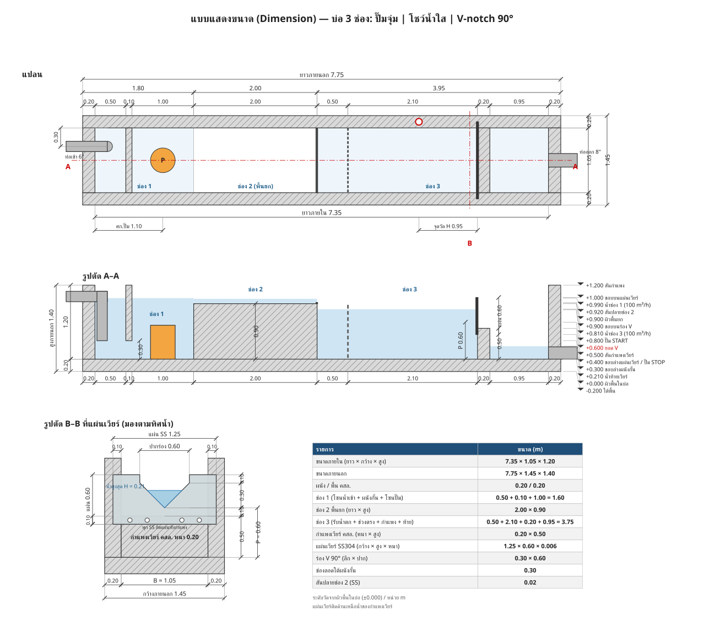
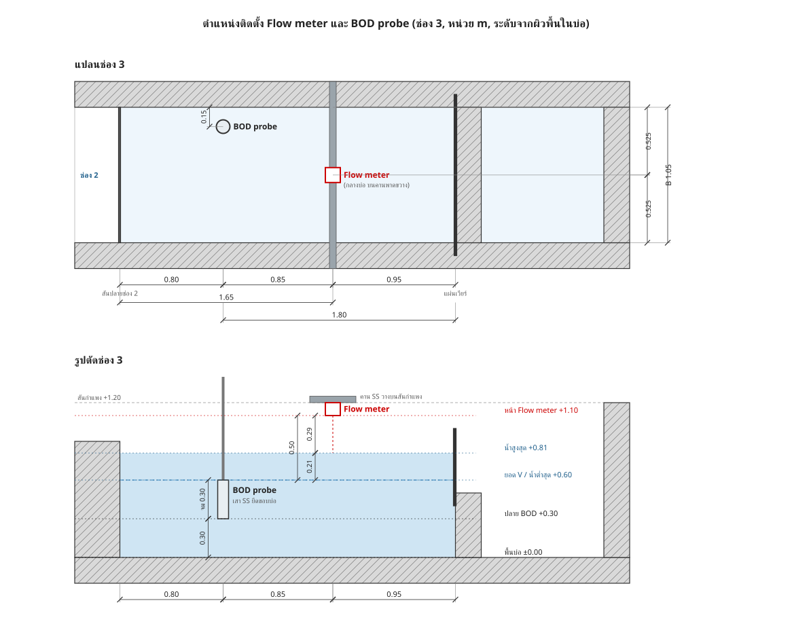

# บ่อ 3 ช่อง: ปั๊มจุ่ม | โชว์น้ำใส | เวียร์ V-notch 90°

```
ท่อ 6" → [ช่อง 1 รับน้ำ + ปั๊มจุ่ม] → [ช่อง 2 พื้นยก น้ำไหลบาง] → [ช่อง 3 V-notch 90°] → ท่อ 8"
                  │
                  └→ Water recycle 10 m³/h
```

| ไฟล์ | รายละเอียด |
|---|---|
| `weir_design.xlsx` | **ไฟล์คำนวณหลัก** แก้ช่องสีเหลืองแล้วทุกขนาดคำนวณใหม่ (ชีต 3 = ที่มาของทุกขนาด) |
| `make_xlsx.py` | สร้างไฟล์ Excel |
| `weir_design.py` | ตัวคำนวณ/ตรวจสอบแบบ Python |
| `make_drawings.py` | สร้างแบบ SVG ในโฟลเดอร์ `drawings/` |

## 1. ข้อมูลออกแบบ

| รายการ | ค่า |
|---|---|
| น้ำเข้า (ตามใบเสนอราคา) | 50 – 100 m³/h (เฉลี่ย 1,507 m³/วัน = 62.8 m³/h) |
| สูบไป Water recycle | 10 m³/h |
| ผ่านเวียร์สูงสุด (ปั๊มหยุด ใช้หาขนาด) | 100 m³/h |
| สูตรเวียร์ (กรมควบคุมมลพิษ) | Q = 1.38 H<sup>2.5</sup> → **Hmax = 0.21 m** |

## 2. แบบ

### แบบแสดงขนาดทั้งระบบ



## 3. ที่มาของขนาด (สรุปจากชีต 3 ใน Excel)

| ขนาด | วิธีคิด | ขั้นต่ำ | ใช้ |
|---|---|---|---|
| **P** ยอด V จากพื้น | MAX(0.45, H ÷ 0.4) + เผื่อตะกอน 0.05 | 0.574 | **0.60** |
| **B** กว้างภายใน | MAX(0.90, H ÷ 0.2, ปากร่อง + 2 × 2H) — ISO + USBR/มข. | 1.439 | **1.45** |
| ลึกร่อง V | H + 0.08 | 0.29 | **0.30** (ปาก 0.60) |
| ช่วงตรงหน้าเวียร์ | 10 × H | 2.097 | **2.10** |
| จุดวัด H | 4.5 × H (ช่วง 4–5 H) | 0.943 | **0.95** |
| ระดับน้ำท้ายเวียร์ | ท่อ 8" ที่พื้น: D/2 + (Q ÷ Cd·A)² ÷ 2g | — | +0.21 (≤ +0.54 ✔) |
| ช่องท้ายเวียร์ | ม่านน้ำพุ่งไกล v·√(2y/g) = 0.71 + เผื่อ 0.20 | 0.909 | **0.95** |
| โซนรับน้ำตก ช่อง 3 | MAX(ระยะทำงาน 0.50, ระยะฟองอากาศลอย 0.27) | 0.50 | **0.50** |
| พื้นยก ช่อง 2 | น้ำช่อง 3 (0.81) + 0.10 − สันปลาย 0.02 | 0.89 | **+0.90** |
| ความยาวช่อง 2 | ≥ 10 × ชั้นน้ำ (0.079) = 0.79 | 0.80 | **1.00** (เลือก) |
| ช่องลอดใต้ผนังกั้น | Q ÷ (B × 0.10 m/s) | 0.265 | **0.30** |
| โซนน้ำเข้า ช่อง 1 | ท่อจุ่ม 0.168 + 2 × 0.15 | 0.468 | **0.50** |
| โซนปั๊ม ช่อง 1 | ฐานปั๊ม 0.40 + 2 × 0.30 | 1.00 | **1.00** |
| สันกำแพง | น้ำช่อง 1 (0.99) + freeboard 0.20 | 1.188 | **+1.20** |
| กำแพงเวียร์ คสล. | สันอยู่ที่ P − 0.10 | — | **+0.50** หนา 0.20 |
| แผ่นเวียร์ SS304 | กว้าง B + 2 × 0.10 / ขอบล่าง +0.40 ถึงขอบบน P + ลึกร่อง + 0.10 | — | **1.65 × 0.60 m** หนา 6 mm (หน่วยแรง 8 MPa ≤ 123 ✔) |
| ผนัง/พื้น คสล. | Mu = 1.7 × γH³/6 = 4.8 kN·m/m → เหล็กตามขั้นต่ำ 600 mm²/m | — | **0.20 m**, DB12@175 |

## 4. ตำแหน่งเซนเซอร์ (ช่อง 3)



| เซนเซอร์ | ตำแหน่ง | ระดับ | ตรวจ |
|---|---|---|---|
| BOD probe (WTW UV 705 IQ SAC) | ต้นช่วงตรง + 0.30 m ชิดผนังข้าง 0.15 m (ห่างแผ่นเวียร์ 1.80 m) | ปลาย probe +0.30 | น้ำในช่อง 3 ค้างที่ยอด V (+0.60) เสมอ → จมน้ำ ≥ 0.30 m ไม่แห้ง |
| Flow meter (หัววัด DL10 ของ Item 1.3) | เหนือจุดวัด H ห่างแผ่นเวียร์ 0.95 m บนคานพาดขวาง | หน้าเซนเซอร์ +1.10 | ระยะถึงผิวน้ำ 0.29–0.50 m อยู่ในช่วงวัด 0.05–1.25 m |

**ขนาดบ่อ:** ภายใน **6.35 × 1.45 × 1.20 m** / ภายนอก **6.75 × 1.85 × 1.40 m**
(ช่อง 1 = 1.60, ช่อง 2 = 1.00, ช่อง 3 = รับน้ำตก 0.50 + ช่วงตรง 2.10 + กำแพงเวียร์ 0.20 + ท้ายเวียร์ 0.95 = 3.75)

ค่าเกณฑ์ที่วิศวกรกำหนด เช่น เผื่อตะกอน ระยะห่างปั๊ม และ freeboard อยู่ในชีต 1 ส่วน "ข" แก้ค่าได้

> แบบนี้เป็นแบบเบื้องต้นด้านชลศาสตร์ ส่วนโครงสร้าง คสล. ต้องให้วิศวกรโยธาออกแบบและรับรองตามหน้างาน
