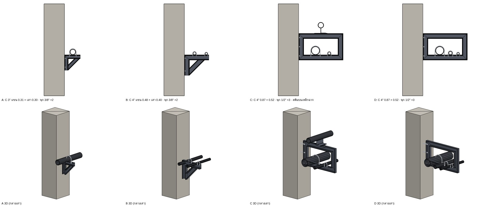
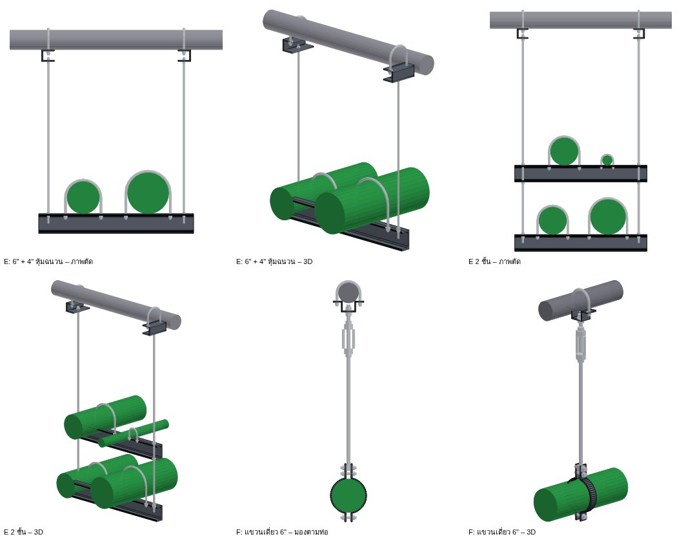
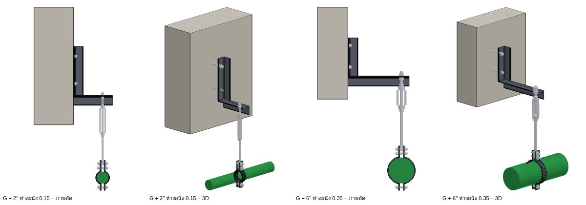
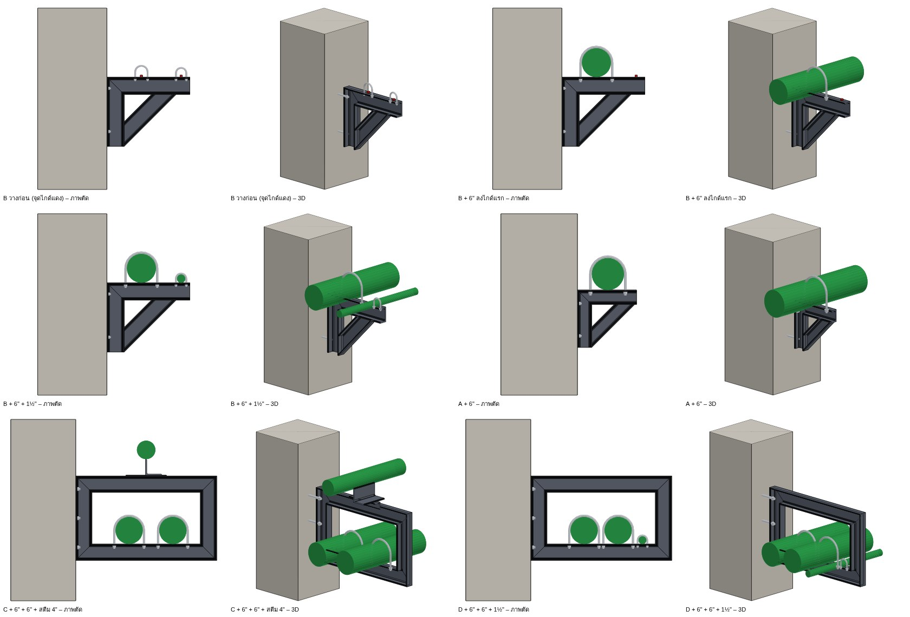

# Steel Supports TH (ซัพพอร์ตเหล็ก) – ปลั๊กอินแยก

ปลั๊กอิน SketchUp ตัวที่สอง (`dist/artk_steel_support-<version>.rbz`) สำหรับ **ซัพพอร์ตมาตรฐาน A B C D ยึดเสา**
และ **E F แขวนจากท่อกลม/โครงทรัส** (2.1) · **G เหล็กฉากยึดผนัง/คาน + แขวน** (2.2) ตามแบบของผู้ใช้ – ขนาดเหล็กและระยะตามแบบทุกตัว วางกึ่งกลางเสาเอง U-bolt รัดท่อจริง ใช้กับท่อของ
**Plant Piping TH 1.16.4 ขึ้นไป** (อ่านขนาด/ฉนวน/น้ำหนักท่อ, วางทุกเสาตามแนวท่อ, Auto Supports ของ Plant Piping
ไม่วางซ้ำ, ลบที่แขวนเดี่ยวที่ตำแหน่งเดียวกัน, วาดท่อลงซัพพอร์ต → ท่อวางบนเหล็ก, วาดท่อเพิ่ม/แก้/ย้ายท่อ → ปรับ U-bolt ตามให้เอง)
และกับท่อทรงกระบอกทั่วไปได้

## แบบซัพพอร์ต (2.0)

| แบบ | เหล็ก | ขนาด (ม.) ตามแบบ | พุก Expansion bolt | ท่อตามแบบ |
|---|---|---|---|---|
| **A** | รางน้ำ 3" C75×40×5×7 | แขน 0.31 จากหน้าเสา × เสา 0.30 + ค้ำยัน 45° | 3/8" × 2 (0.07, 0.24 ใต้หลังแขน) | ท่อประปา 3"/4" ที่ 0.16 |
| **B** | รางน้ำ 4" C100×50×5×7.5 | แขน 0.48 × เสา 0.40 + ค้ำยัน 45° | 3/8" × 2 (0.065, 0.315) | 2 เส้น ที่ 0.20 และ 0.43 (0.20 + 0.23) |
| **C**, **D** (2.3) | รางน้ำ 4" | โครงกล่อง 0.87 ออกจากเสา × 0.52 สูง | 1/2" × 3 (0.08, 0.26, 0.44 จากบน) | **ประปา 6"** บนคานล่าง ที่ 0.29 (0.19 จากด้านในเสาโครง) U-bolt 1/2" · **ลม 2" แขวนใต้คานบน** ที่ 0.50 (U-bolt ใต้ท่อ ขาขึ้นทะลุปีกล่างของคานบน น็อตในราง) · **สตีม 2" + ฉนวน 25** บน **shoe** สูง 50 (เพลท 6 มม. ฐาน 110×200 + แผ่นตั้งเชื่อมท่อ) ระหว่าง**ไกด์เหล็กฉาก L50 ยาว 0.10** 2 ตัว ที่ 0.65 (0.12 จากด้านในเสาโครงหน้า) – ท่อร้อนเลื่อนตามแนวท่อได้ ไม่รัด U-bolt |

C และ D ตั้งแต่ 2.3 เป็นแบบเดียวกัน (แบบใหม่ของผู้ใช้) · ระยะระหว่างศูนย์ 6" กับสตีมตามแบบ 0.19 + 0.12 ภายในโครง 0.67 = **0.36**
(เส้นมิติ 0.32 ในแบบเริ่มเยื้องจากศูนย์ท่อ 6" ไป 0.04) · แบบ 2.0: C มีสตีม 4" บน shoe บนคานบน (ท่อที่วางบนคานบนอยู่แล้วยังรับแบบเดิม),
D มี 3 เส้นที่ 0.33, 0.54, 0.69 (ท่อที่ผ่านตำแหน่งเดิมยังรัด U-bolt ตามท่อจริง)

- เหล็ก **ตั้งเอว** (web อยู่ในระนาบซัพพอร์ต – เห็นความลึก 75/100 มม. ในภาพตัดตามแบบ) มุมต่อเฉียง 45° (mitre),
  ปีกหลังของเสาแนบหน้าเสา ยึดพุก น็อตอยู่ด้านในราง · ท่อวางบนปีกบนของแขน/คานล่าง รัด U-bolt ลอดปีก น็อตใต้ปีก
  (A/B: แหวนรองใต้ปีกต้องพ้นปีกหลังของเสาที่แนบเสา – ปีกหน้าของเสาตัดเฉียงจบต่ำกว่าน็อต · C/D: พ้นเสาโครงทั้งสองข้าง)
- ค้ำยัน A/B: ขอบล่างจากโคนเสาด้านในขึ้น 45° ถึงใต้แขน (A ถึงปลายแขน 0.30, B ถึง 0.40)
- **ระยะเหล็กตามแบบเสมอ** – ขนาดไม่เปลี่ยนตามน้ำหนัก (ผลตรวจกำลังแสดงในรายงาน/คำเตือนเท่านั้น)

## E, F – แขวนจากท่อกลม (2.1)

แบบ E ไม่มีตัวเลขในแบบ – วัดสัดส่วนจากรูป (คานล่าง C 4" ทำให้ท่อซ้ายเป็น 6" พอดี) · แบบ F ไม่มีระยะ – ใช้มาตรฐานเดียวกับ A–D
(MSS SP-58/SP-69):

| แบบ | ส่วนประกอบ | ขนาด |
|---|---|---|
| **E** | คานรับท่อรางน้ำ 4" (C100×50) ยาว 0.80 · เหล็กเส้นเกลียว 2 เส้น ห่าง 0.70 (เข้าจากปลาย 0.05) · หัวบน: ตัวยึด C เพลทพับ 6 มม. ใต้ท่อกลม + U-bolt คร่อมท่อกลม (ขนาดตามท่อกลม) · น็อตรับใต้ปีกคาน + น็อตล็อกบน | ท่อตามแบบที่ 0.23 (6") และ 0.565 (4" หุ้มฉนวน 50) จากปลาย · เหล็กเส้นตามน้ำหนัก 3/8"–5/8" (MSS SP-58) |
| **E 2 ชั้น** | คานชั้นบนบนเหล็กเส้นชุดเดียวกัน (น็อตรับใต้ปีกล่าง + ล็อกบน) | ชั้นบนสูงกว่าชั้นล่าง 0.42 (หลังคาน–หลังคาน เท่าคานบน–คานล่างของ C) |
| **F** | ตัวรับ U เพลทพับ 6 มม. (มีปีก) ใต้ท่อกลม + U-bolt คร่อมท่อกลม · เกลียวเร่ง (MSS type 13, ยาว 150) · เหล็กเส้น 1 เส้น · แคลมป์รัดท่อ 2 สลัก (MSS type 4): หูบน 2 สลัก, หูล่าง 1 สลัก | เหล็กเส้นตามน้ำหนัก แต่ไม่เล็กกว่า MSS SP-69 (≤2" 3/8", 2½"–3½" 1/2", 4"–5" 5/8", 6" 3/4") · แถบแคลมป์ ≤2" 5×25, 2½"–4" 6×32, 5"–6" 6×38 · สลักแคลมป์ 3/8" (≤2") / 1/2" |

- **เข้ากึ่งกลางท่อกลมเอง** (ไม่ต้องสแนป Center): รังสีหาท่อกลมด้านบน แล้ววางระนาบซัพพอร์ตผ่านแกนท่อกลม
- **E**: ชี้ท่อ (Plant Piping) ใต้ท่อกลม → ระดับคานล่าง = ท้องท่อล่างสุด · ท่อซ้อนกัน 2 ชั้น → **2 ชั้นเอง** (ชั้นบน = ท้องท่อชั้นบน) ·
  คานเลื่อนตามขวางให้ท่อทุกเส้นอยู่ระหว่างเหล็กเส้น · ไม่มีท่อ: **คลิกท่อกลม** (ตรงไหนก็ได้ – เข้าแกนเอง, กึ่งกลางคานตรงที่คลิก)
  แล้ว **พิมพ์ระยะจากใต้ท่อกลมลงถึงท้องท่อ** (มม.) หรือคลิกจุดที่ระดับท้องท่อ · E 2 ชั้น (ปุ่ม E2) = 2 ชั้นแม้ยังไม่มีท่อชั้นบน
- **F**: สำหรับท่อที่เลี้ยวให้วิ่งแนวเดียวกับโครงทรัส – ชี้ท่อ → หาท่อกลมเหนือท่อ (ตามแนวท่อ หรือขวางท่อก็ได้) วางใต้แกนท่อกลม ·
  คลิกท่อกลม + พิมพ์ระยะลงก็ได้ (ท่อจะวิ่งตามท่อกลม) · **วางตามแนวท่อ** (ปุ่มเดียวกับ "ทุกเสา"): เลือกแนวท่อ → F ทุกระยะซัพพอร์ตของท่อ
  (ระยะสูงสุดตามขนาดท่อ) ที่มีท่อกลมอยู่เหนือ · แคลมป์ตามท่อจริงเสมอ (ท่อย้าย → แคลมป์ตาม, ตัวรับบนท่อกลมอยู่ที่เดิม) ·
  เหล็กเส้นเอียงเกิน 4° (ท่อเยื้องจากแนวท่อกลม) → แจ้ง · ระยะแขวนสั้น → ไม่ใส่เกลียวเร่ง
- ท่อกลมที่วาดด้วย Plant Piping (รังสีมองข้ามท่อของ Plant Piping): ชี้แล้วไม่พบท่อกลมด้านบน → ใช้ท่อนั้นเป็นท่อกลมที่จะแขวน (คลิก + พิมพ์ระยะ)
- วาดท่อลงซัพพอร์ตทีหลังได้เหมือน A–D (เส้นไกด์ = ท้องท่อ ทั้ง 2 ชั้นของ E) · เลขที่ E-01 … (E 2 ชั้นนับรวมกับ E), F-01 …

## G – เหล็กฉาก + แฮงเกอร์ (2.2)

สำหรับท่อที่วิ่งตามผนัง/คาน (ร่างของผู้ใช้: เหล็กฉากรูปตัว L ยึดข้างคาน แขวนลงมาที่ท่อ) – ไม่มีระยะในแบบ ใช้มาตรฐานเดียวกับ A–F:

- **เหล็กฉาก 2 ชิ้นเป็นรูป L**: ขายึดผนัง/คาน (ขาแบนแนบผิว พุก Expansion bolt 2 ตัวที่ 0.06 และ H−0.05 จากโคน) + แขนยื่นออกไปเหนือท่อ
  (ขาบนแบน ขาตั้งห้อยลง) ยาวถึงเหล็กเส้น + 0.05 · ขนาด **L50 → L65 → L75 → L100 ตัวเล็กสุดที่ผ่าน** แรงดัด ≤ 0.6Fy, แอ่น ≤ L/180,
  พุก 3/8" ขึ้นไป (แรงดึงจากโมเมนต์ + เฉือน) · ขายาว 250 (L50–L65) / 3.5 × ขา · แขนเกิน 0.70 → แจ้งให้ใช้ขาค้ำ (A/B)
- **แขวนแบบ F**: เหล็กเส้นทะลุขาบนของแขน (น็อต+แหวนบน, ล็อกใต้) · เกลียวเร่ง · แคลมป์รัดท่อ 2 สลัก · เหล็กเส้นตามน้ำหนัก ≥ MSS SP-69
- **ชี้ท่อ** → หาหน้าผนัง/คานด้านบนข้างท่อเอง (รังสีขวางท่อจากเหนือท่อขึ้นไปทีละ 25 มม. – ระดับต่ำสุดที่ขายึดอยู่บนผิวเดียวกันทั้งท่อน
  เช่นใต้คานพอดี) ห่างได้ถึง 1 ม. · เสาแคบ → กึ่งกลางเสา
- **ชี้หน้าผนัง/คานที่ระดับหลังแขน** (จุดล็อก ✕ = หลังแขนที่ผิว) → แขวนท่อที่อยู่ใต้แขน · ยังไม่มีท่อ → ท่อตามแบบ 4" ห่างผิว 0.25 ใต้แขน 0.40
  (วาดท่อลงเส้นไกด์ทีหลังได้ แคลมป์ตามท่อ)
- **วางตามแนวท่อ**: เลือกแนวท่อ → G ทุกระยะซัพพอร์ตที่มีผนัง/คานข้างท่อ

## วาง

1. **ชี้ท่อที่ผ่านเสา** แล้วคลิก → ปลั๊กอินหาหน้าเสาข้างท่อ (≤ 3 ม.) แล้ววาง **กึ่งกลางหน้าเสา** ตามแนวท่อ
   (หน้ากว้างเกิน 1.2 ม. = ผนัง → วางตรงที่ชี้) · ระดับหลังเหล็กรับท่อ = ใต้ท่อที่ต่ำที่สุดในซัพพอร์ต
   (คลิกท่อสตีมของแบบ C ได้ – ระดับตามท่อด้านใน) · ท่อเกินระยะแขน/ชิดเสาเกิน → แจ้ง ไม่วาง
2. **ชี้หน้าเสา (หรือขอบ/มุมเสา) ที่ระดับท้องท่อ** – จุดคลิก = **จุดล็อก: มุมในบนเหล็กรับท่อที่หน้าเสา** (บนแขน A/B,
   บนคานล่าง C/D – ระดับเดียวกับเส้นไกด์ / ท้องท่อ, เครื่องหมาย ✕ ในภาพตัวอย่าง; 2.0.2–2.0.7 เป็นบนสุดของซัพพอร์ต)
   (ยังไม่มีท่อก็ได้) → กึ่งกลางเสาเหมือนกัน · ท่อที่ผ่านในซัพพอร์ตได้ U-bolt ทุกเส้น · ไม่มีท่อ = U-bolt ตามแบบ +
   **จุดไกด์/เส้นไกด์ (แดง) บนเหล็ก** ที่ตำแหน่งท่อตามแบบ – ดูหัวข้อ *วางซัพพอร์ตก่อน แล้ววาดท่อ*
3. **วางทุกเสาตามแนวท่อที่เลือก** (ท่อ Plant Piping): ไล่ตามแนวท่อทุก 10 ซม. หาหน้าเสาข้างท่อในระยะแขน
   → วางแบบที่เลือกที่กึ่งกลางทุกเสา (ข้ามเสาที่มีซัพพอร์ตเหล็กอยู่แล้ว)

**C / D บนผนัง Iso wall (ห้ามเจาะ/ยึดผนัง, 2.4):** เปิด *"C / D แขวนจากท่อกลมด้านบน"* ในหน้าต่าง (หรือกด **Alt** ในเครื่องมือวาง)
→ โครงเดิมทุกระยะ แต่**ไม่มีพุก** ห่างผนัง 20 มม. แขวนจากท่อกลมที่วิ่งขวางเหนือโครง (หาเองด้วยรังสี เลื่อนเข้าแกนท่อกลมตามแนวท่อ) ด้วย
**pipe shoe แคลมป์ปรับระดับ 2 ตัว** (แบบในรูปของผู้ใช้ กลับหัว): ฐานเพลท 8 มม. ยึดปีกบนของคานบนด้วยสลัก 1/2" ×2 (น็อตใต้ปีก), ปลอก + เสาแบนปรับสูง
(สลักล็อก), แคลมป์ 2 สลักรอบท่อกลม (ขนาดแถบ/สลักตามท่อกลม) · ตำแหน่ง 0.15 จากปลายทั้งสองข้างของคานบน · ตรวจ: คานบนรับแรงจากเสาโครงไปถึง shoe,
สลักฐาน · ใต้ท่อกลมต้องสูงกว่าหลังคานบน ≥ 98 มม. (สูงเกิน 400 → แจ้งให้ใช้เหล็กเส้น) · ไม่มีท่อกลมด้านบน → แจ้ง (ปิดโหมดเพื่อใช้พุก) ·
ค่ารับแรงของ pipe shoe/แคลมป์ใช้ตามผู้ผลิต

**ท่อร้อน (บริการ สตีม/น้ำร้อน ของ Plant Piping) บนคานล่างของ C/D → shoe + ไกด์** แทน U-bolt (shoe สูงถึงใต้ท่อเปล่า; ต่ำกว่าฉนวน → แจ้ง) ·
**ท่อที่ผิวบนชิดใต้คานบน (≤ 30 มม.) → แขวนใต้คานบน** (U-bolt ขึ้น, แผ่นรองถ้าเว้นช่อง) · วาดท่อลงซัพพอร์ต: เส้นไกด์ของลมอยู่ใต้คานบน
(ท่อห้อยลงจากเส้น ผิวบนแตะคาน), ของสตีมอยู่บนหลัง shoe (ท่อเปล่าวางบน shoe – ท่อมีฉนวนที่วาดใกล้ 0.65 เข้า shoe เอง)

**U-bolt ตามท่อจริง (ไม่ต้องเป็นแบบในรูป):** มีท่อผ่าน 1, 2, 3, 4 … เส้น ตำแหน่งไหนก็ได้ในแขน/โครง – ใส่ U-bolt ทุกเส้น
ตำแหน่ง/ขนาด U-bolt ตามท่อที่อยู่ในซัพพอร์ต (½"–2" = 3/8", 2½"–6" = 1/2" = ST 1/2" ของแบบ C),
คร่อมผิวฉนวน · ท่อสูงกว่าหลังเหล็ก ≤ 300 มม. มีแผ่นรอง · สตีมของ C: ขาเหล็กฉาก 4" ตัดตามระดับท่อ (ท่อสูงกว่า = แผ่นรองใต้ shoe)
· ท่ออยู่นอกตำแหน่ง → แจ้งในหมายเหตุ ไม่รัด

**ปรับตามท่อ:** เหล็กอยู่ที่เดิม (ยึดเสาแล้ว) สร้าง U-bolt/แผ่นรองใหม่ตามท่อปัจจุบัน – ทำเองเมื่อวาด/แก้/ย้าย/แปลงเส้นเป็นท่อ
ด้วย Plant Piping, หรือกดปุ่ม *ปรับตามท่อ* (ซัพพอร์ตที่เลือก หรือทั้งหมด) · **ซัพพอร์ตไม่เลื่อนเอง** (ยึดเสาที่ระดับที่วางไว้):
ท่อสูงกว่าเหล็ก ≤ 300 มม. → แผ่นรอง · ท่อที่วาด/ย้ายจน**จมในเหล็กรับท่อ** (แขน / คานล่าง) → ไม่รัด แจ้งในหมายเหตุ
"ท่อ … จมในเหล็ก … มม." (ไม่ใส่ U-bolt ตามแบบทับท่อนั้น)

## วางซัพพอร์ตก่อน แล้ววาดท่อ (2.0.7 + Plant Piping 1.16.4)

1. วางซัพพอร์ตที่ระดับที่ต้องการ (คลิกหน้าเสาที่ระดับท้องท่อ – 2.0.8) → มี **จุดไกด์ + เส้นไกด์บนผิวเหล็กรับท่อ** ตรงตำแหน่งท่อตามแบบ
   (C: ท่อสตีมที่หลัง shoe) – **เส้นไกด์ = ท้องท่อ** (ยาว ±0.5 ม. จากซัพพอร์ต) มี**จุดสแนปกลางเส้นและที่ปลายทั้งสองข้าง** (2.2.1 –
   ซัพพอร์ตที่วางก่อนหน้า: กด *ปรับตามท่อ* ครั้งเดียวเพื่อเพิ่มจุดปลาย)
2. วาดท่อด้วยเครื่องมือวาดท่อของ Plant Piping **ชี้บนผิวเหล็ก หรือจุดไกด์ / เส้นไกด์** → ขึ้น
   "วางบนซัพพอร์ต B-01 ที่ 0.20 ม. จากหน้าเสา" · ท่อ**เข้าตำแหน่งตามแบบที่ใกล้ที่สุด** (ภายใน 12 ซม.) ที่ยังว่างและท่อขนาดนั้น
   ลงได้ (ไม่ต้องคลิกให้ตรงจุดไกด์) – ไม่มีตำแหน่งว่างใกล้ ๆ = ตรงที่ชี้ · ท่อถูกยกขึ้นให้ใต้ท่อ (รวมฉนวน) วางบนเหล็กพอดี ทุกขนาด
   (สตีมของ C: ท่อเปล่าวางบน shoe ฉนวนหุ้มรอบ) · ชี้บนเหล็ก = จุดอยู่แนวกึ่งกลางซัพพอร์ต (เหมือนจุดไกด์) ท่อจึงผ่านซัพพอร์ตเสมอ ·
   สแนปเส้นไกด์ได้แม้ SketchUp ไม่บอกว่าเส้นนั้นอยู่ในกลุ่มไหน (1.16.4/2.0.7: ดูจากตำแหน่งจุดบนเส้นไกด์/เหล็กของซัพพอร์ตทุกตัว)
3. ปล่อยเมาส์จบเส้นปุ๊บ ซัพพอร์ตตรวจจับท่อแล้ว **สร้าง U-bolt ตามขนาดท่อทันที** (½"–2" = 3/8", 2½"–6" = 1/2") ·
   ตำแหน่งตามแบบที่ยังว่างยังมีจุดไกด์ให้วาดเส้นต่อไป
4. ท่อ 6" ลงได้: A ที่ 0.16 · B ที่ 0.20 · C ที่ 0.33, 0.60 · D ที่ 0.33, 0.54 (B ที่ 0.43 เกินปลายแขน, D ที่ 0.69 ชนเสาโครงหน้า →
   แจ้งในหมายเหตุ ไม่รัด)

ซัพพอร์ตที่วางด้วย 2.0.4 (จุดไกด์อยู่กลางท่อ 2") วาดลงจุดไกด์เดิมก็วางบนเหล็กได้เหมือนกัน และสร้างจุดไกด์ใหม่บนเหล็กเมื่อปรับตามท่อครั้งถัดไป
· ซัพพอร์ต **ไม่เลื่อนตามท่อ** (2.0.5 เลื่อนลงเมื่อท่อจมในเหล็ก – ยกเลิกแล้ว: ซัพพอร์ตที่เลื่อนไปแล้วให้ลบแล้ววางใหม่)
· Plant Piping ต้อง **1.16.4 ขึ้นไป** (1.16.3: สแนปเส้นไกด์แล้วบางครั้งท่อไม่ถูกยก · 1.16.2: ท่อวางบนเหล็กแต่ไม่เลือกตำแหน่งตามขนาดท่อ · ก่อนนั้น: ซัพพอร์ตยังปรับ U-bolt
ตามท่อได้ แต่ท่อไม่ถูกยกขึ้นวางบนเหล็ก)

## รายการวัสดุ + ตรวจกำลัง

เหล็กแยกขนาด (ยาวรวม +5 % เผื่อตัด, กก.: A = 0.31 + 0.30 + 0.32 ม., B = 0.48 + 0.40 + 0.42 ม., C/D = 2.78 ม./ชุด
+ เหล็กฉากของ C), แผ่นรอง, U-bolt แยกตามท่อ, พุก, น็อต + แหวน, ผลตรวจทุกตัว · บันทึก CSV (Excel ภาษาไทยได้)
ตรวจ: คานรับท่อ (หน่วยแรงดัดแกนแข็ง ≤ 0.6Fy SS400, แอ่น ≤ L/240), ค้ำยัน (แรงอัด ≤ Fa AISC ASD),
พุก (แรงดึงจากโมเมนต์พลิก + แรงเฉือน, ค่าทั่วไปคอนกรีต 210 ksc – ตรวจค่าผู้ผลิต) · น้ำหนักท่อ = ท่อ + ของเหลว + ฉนวน ×
ระยะห่างซัพพอร์ต (ตั้งเอง หรือระยะสูงสุดตามขนาดท่อ)

## ข้อมูลที่เก็บในโมเดล (เพิ่ม key ได้อย่างเดียว)

กลุ่มละหนึ่งซัพพอร์ต, dictionary `ArtK_SteelSupport`:

| key | ความหมาย |
|---|---|
| `kind` | `support` |
| `format` | 1 |
| `detail` | `A` `B` `C` `D` (2.0) · `E` `E2` `F` (2.1) · `G` (2.2) · `wf` `wb` `th` `tt` (แบบของ 1.0 – ไม่อยู่ในเครื่องมือแล้ว แต่ไฟล์เก่ายังปรับตามท่อได้) |
| `number` | เช่น `A-01` (ตัวนับใน model attribute `seq_<detail>`) |
| `section`, `anchor` | หน้าตัด (`C75` / `C100`), ขนาดพุก (`3/8` / `1/2`) |
| `origin`, `xdir`, `ydir` | A–D: จุดบนหน้าเสา กึ่งกลางเสา ที่ระดับหลังเหล็กรับท่อ (world mm; ไม่เปลี่ยนเมื่อปรับตามท่อ); x ตามแนวท่อ, y ออกจากหน้าเสา, z ขึ้น · E: ปลายคานล่างที่หลังคาน (y ตามคาน) ใต้แกนท่อกลม · F: ใต้แกนท่อกลม ที่ท้องท่อตอนวาง · G: ใต้เหล็กเส้น ที่ท้องท่อตอนวาง (y ออกจากผิว) |
| `hit_dir`, `ref` | ท่อ/หน้าเสาที่คลิก (`src` = `pp` / `generic` / `face`) |
| `opts` | ค่าที่ใช้ตอนวาง |
| `pipes` | JSON `[{pid, label, y, z, od, ins, src, at}]` – `at` = จุดบนแกนท่อ (world) ที่ Plant Piping นับเป็นจุดรองรับ |
| `struct` | A–D: `face` (ระยะท่อที่คลิกถึงหน้าเสา), `column` (ความกว้างเสา, null = ผนัง) · C/D แขวน (2.4): `hang` {`z` แกนท่อกลมเหนือหลังคานล่าง, `r`} · E: `chord` {`z` แกนท่อกลมเหนือหลังคานล่าง, `r`}, `gap` (หลังคานบนเหนือคานล่าง, null = ชั้นเดียว) · F: `chord` {`z`, `r`, `along` `x` ตามท่อ / `y` ขวางท่อ} · G: `mount` {`z` หลังแขนเหนือ origin, `face` ตำแหน่งผิว (y < 0)}, `face`, `column` |
| `rod` | E, F, G: ขนาดเหล็กเส้นเกลียว (`3/8` … `3/4`) · G: `section` = เหล็กฉากที่เลือก, `anchor` = ขนาดพุก |
| `guides_v` | 2 = จุดไกด์กลาง + ปลายเส้นทั้งสองข้าง (2.2.1; ไม่มี/น้อยกว่า → ปรับตามท่อครั้งถัดไปสร้างใหม่) |
| `bom`, `checks`, `notes`, `info` | รายการวัสดุ, ผลตรวจ, หมายเหตุ, `info.nominal` (ยังไม่มีท่อ), `info.guides` (กึ่งกลางท่อตามแบบที่ตำแหน่งยังว่าง), `info.rests` (2.0.5: `[y, z]` ใต้ท่อของตำแหน่งนั้น = จุดไกด์บนเหล็ก) |

## ใช้ร่วมกับ Plant Piping (API)

Plant Piping 1.16.1 มี `ArtK::PlantPipe::API` (LEVEL 1, `src/artk_plant_pipe/su/api.rb`): `pipe_at`, `pipes_across`,
`info`, `runs`, `support_points`, `drop_hangers`, `register_supports`, `on_runs_changed`, `ours?` · 1.16.2 (LEVEL 2) เพิ่ม
`register_rests` (1.16.3: ส่งขนาดท่อที่กำลังวาด `{ od:, ins: }` เป็นอาร์กิวเมนต์ที่ 4 · 1.16.4: เรียกแม้ path ว่าง) · Steel Supports ลงทะเบียน `register_supports` (Auto Supports ของ Plant Piping เว้นจุดที่ซัพพอร์ตเหล็กรับ),
`on_runs_changed` (ปรับตามเมื่อวาด/แก้/ย้าย/แปลงเส้นเป็นท่อ) และ `register_rests` (เครื่องมือวาดท่อวางท่อบนเหล็ก:
`Builder.rest_at` → `Std.rest`)
